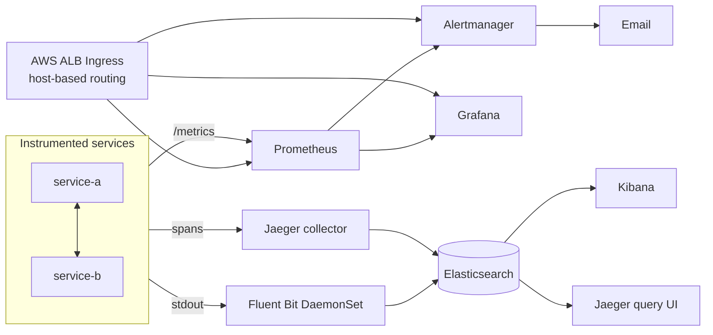

# Kubernetes Observability on EKS: Metrics, Logs and Traces

Two hands-on builds on Amazon EKS that cover the three signals end to end, from instrumented application code through collection to alerting and dashboards.

> **Hands-on build, not client work.** Built and run in my own AWS account, following Abhishek Veeramalla's [Observability Zero to Hero](https://github.com/iam-veeramalla/observability-zero-to-hero) course. Most manifests and the sample applications come from the course; my changes are listed [below](#what-i-changed-from-the-course). Write-up on [Medium](https://medium.com/@said-devops).

## What's here

| Folder | Stack | Signal |
|---|---|---|
| [`k8s-monitoring-logging-tracing/`](k8s-monitoring-logging-tracing/) | kube-prometheus-stack (Prometheus, Alertmanager, Grafana), Elasticsearch + Fluent Bit + Kibana, Jaeger | Metrics, logs and traces from two instrumented Node.js services |
| [`open-telemetry-project/`](open-telemetry-project/) | OpenTelemetry Collector → Jaeger (Elasticsearch storage) and Prometheus | Vendor-neutral traces and metrics from two Go services over OTLP |
| [`opensearch-stack/`](opensearch-stack/) | Fluent Bit → OpenSearch | The course's alternative log backend, kept unchanged for reference |

## Architecture

In the OpenTelemetry build, the services send OTLP to a single Collector. The Collector fans traces out to Jaeger and exposes metrics on `:8889` for Prometheus to scrape, so the application code has no dependency on any particular backend.

## What I changed from the course

- **Host-based ALB ingress** for Prometheus, Grafana and Alertmanager, with one subdomain each, replacing the course's path-based routing. Grafana and Prometheus assume they are served from `/`; under a sub-path they need extra `root_url`/`external-url` settings. ([`ingress_kube_prom_stack.yaml`](k8s-monitoring-logging-tracing/Monitoring-manifests/ingress_kube_prom_stack.yaml), [`alb_controller.md`](k8s-monitoring-logging-tracing/Monitoring-manifests/alb_controller.md))
- **Kibana values**:
  - an NLB with `target-type: ip`, so health checks hit the pods rather than the nodes;
  - a service-account token for Elasticsearch;
  - resource requests and limits sized so the pods would schedule.

  ([`kibana-values.yaml`](k8s-monitoring-logging-tracing/Logging-manifests/kibana-values.yaml))
- **Collector and Prometheus Helm values** for the OpenTelemetry build, and an `attributes` processor in the Collector that converts `net.sock.peer.port` to a string. ([`otel-collector-values.yaml`](open-telemetry-project/otel-collector-values.yaml), [`prometheus-values.yaml`](open-telemetry-project/prometheus-values.yaml))
- **No credentials in the values files.** Fluent Bit reads the Elasticsearch password from the chart's `elasticsearch-master-credentials` secret as an environment variable, instead of having it pasted into the config.
- Built and pushed my own images of the sample services to Docker Hub (`abdihakimdevops/*`).

## What broke, and the fix

| Symptom | Cause | Fix |
|---|---|---|
| Kibana could not connect to Elasticsearch | The service-account token in the Kibana values didn't match the cluster's | Generated a fresh token from Elasticsearch and redeployed Kibana with it |
| The NLB in front of Kibana failed its health checks | It targeted nodes, not pods | `aws-load-balancer-target-type: ip` |
| Pods stuck in `Pending` | Requests too small for the stack on `t3.medium` nodes | Tuned the requests and limits |

## Alerting

[`alerts.yml`](k8s-monitoring-logging-tracing/Monitoring-manifests/alerts-alertmanager-servicemonitor-manifest/alerts.yml) defines two rules, routed by Alertmanager to email:

- **HighCpuUsage**: a warning when average CPU stays above 50% for 5 minutes.
- **PodRestart**: a critical alert when a pod restarts more than twice. You can trigger it with the app's `/crash` endpoint to test the email path end to end.

A `ServiceMonitor` scrapes the services' custom metrics: `http_requests_total`, request duration as both a histogram and a summary, and a gauge.

## Run it

Each folder's README has the full steps. In outline:

1. Create the EKS cluster with `eksctl`, then install the EBS CSI driver (Elasticsearch needs persistent volumes).
2. Metrics: `helm install` kube-prometheus-stack with [`custom_kube_prometheus_stack.yml`](k8s-monitoring-logging-tracing/Monitoring-manifests/custom_kube_prometheus_stack.yml), then `kubectl apply -k` the app and the alert manifests.
3. Logs: install Elasticsearch, Kibana and Fluent Bit with the values in `Logging-manifests/`.
4. Traces: install Jaeger with Elasticsearch as its storage backend.
5. Delete the cluster when you're done (`eksctl delete cluster`). The nodes, NAT gateway and load balancers are all billable.

## What I'd do differently in production

- **Lighter logging.** Use Loki or a managed backend such as Amazon OpenSearch Service, instead of running Elasticsearch in-cluster on small nodes.
- **No hand-edited secrets.** Put the Alertmanager SMTP credentials in AWS Secrets Manager via External Secrets.
- **TLS verification on.** Fluent Bit and Jaeger currently set `tls.verify Off` / insecure. I'd mount the Elasticsearch CA and verify instead.
- **SLO-based alerts.** Alert on burn rate against an SLO rather than raw CPU, and link each alert to a runbook.
- **GitOps.** Run the Helm releases through Argo CD rather than `helm install` by hand.

## Credits

The course material, manifests and sample applications are by [Abhishek Veeramalla](https://github.com/iam-veeramalla/observability-zero-to-hero).
