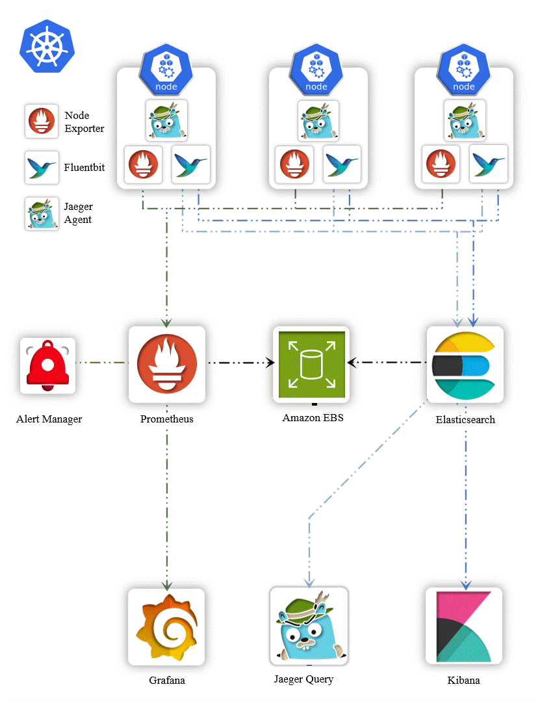

# Logging overview
- Logging is crucial in any distributed system, especially in Kubernetes, to monitor application behavior, detect issues, and ensure the smooth functioning of microservices.

# Architecture

## Importance:
- **Debugging**: Logs provide critical information when debugging issues in applications.
- **Auditing**: Logs serve as an audit trail, showing what actions were taken and by whom.
- **Performance** Monitoring: Analyzing logs can help identify performance bottlenecks.
- **Security**: Logs help in detecting unauthorized access or malicious activities.

## Tools Available for Logging in Kubernetes
- EFK Stack (Elasticsearch, Fluentbit, Kibana)
- EFK Stack (Elasticsearch, FluentD, Kibana)
- ELK Stack (Elasticsearch, Logstash, Kibana)
- Promtail + Loki + Grafana

## EFK Stack (Elasticsearch, Fluentbit, Kibana)
- EFK is a popular logging stack used to collect, store, and analyze logs in Kubernetes.
- **Elasticsearch**: Stores and indexes log data for easy retrieval.
- **Fluentbit**: A lightweight log forwarder that collects logs from different sources and sends them to Elasticsearch.
- **Kibana**: A visualization tool that allows users to explore and analyze logs stored in Elasticsearch.

